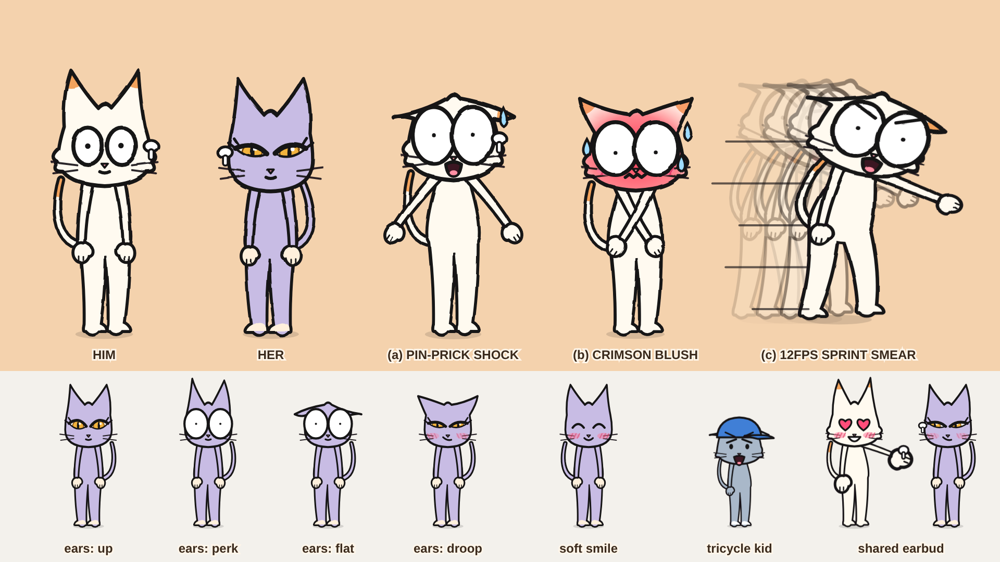

# CatAnime 🐾🚃

A reusable **2.5D zero-dialogue cat-anime engine** built on [Remotion](https://www.remotion.dev) + three.js, plus
**Episode 1 — _“The Last Seat on the 8:15 Train”_** (3:00 · 5400 frames · 1920×1080 · 30fps).

- Flat low-poly 3D sets (peach walls, white tiles, sunlit city) rendered with `@remotion/three`
- Hand-drawn-feel 2D SVG cats on top, stepped to **12fps flipnote holds** with boiling ink lines, smear frames and follow-through
- Hard-cut **rotoscope** inserts (high-contrast B&W, 16mm grain) for peak-panic beats
- **Procedural audio**: every SFX is synthesized to real PCM `.wav` by a Node script, with a beat-synced classical score + ducking



## Quick start

```bash
npm install
```

```bash
npm run sfx          # synthesize public/sfx/*.wav + placeholder score in public/music/
```

```bash
npm run studio       # open Remotion Studio
```

```bash
npm run typecheck
```

Render preview stills (defaults to frames 200, 900, 1700, 3800, 5100 → `out/preview/`):

```bash
npm run stills
```

Render the full episode locally:

```bash
npm run render:ep01  # → out/ep01-the-last-seat.mp4
```

> Rendering uses ANGLE/SwiftShader so it works on CPU-only machines. On a machine with a GPU you can try
> `--gl=angle-egl` or `--gl=vulkan` for a big speed-up. Remotion downloads its own headless Chrome the first
> time; set `REMOTION_BROWSER_EXECUTABLE` to use an existing one (see `remotion.config.ts`).

## Episode 1 timeline

| Scene | Frames | Time | Beat |
|---|---|---|---|
| 1 · The Last Empty Seat | 0–450 | 0:00–0:15 | Enter from opposite doors, lock eyes over one empty seat → vertigo dolly-zoom, sparkles, double `heartbeat_sub` |
| 2 · Chivalry Short-Circuit | 450–1650 | 0:15–0:55 | Over-bow → `comic_bonk` on the pole → `earbud_pop` under her shoe → crimson-face overload, Dutch push-in |
| 3 · Rotoscope Panic & Imagination Spiral | 1650–3300 | 0:55–1:50 | `vine_boom` hard-cut to rotoscope hand/eyes → thought-cloud montage (sit together → nap on shoulder → grow old) → panic orbit → `door_chime` → rotoscope hand through the doors → dive & face-plant |
| 4 · The City-Wide Train Chase | 3300–4650 | 1:50–2:35 | She holds up his earbud in the departing window → stairs sprint (smears) → overpass vault → borrowed tricycle downhill beside the elevated train (`tricycle_bell`) → ticket-gate burst → skid at the next station |
| 5 · The Saved Seat | 4650–5400 | 2:35–3:00 | Silence. Earbud returned, backpack lifted off the seat she saved, she shares one of her earbuds (`romantic_sparkle`) — and the tricycle kid glares through the window as the train leaves |

All beats live in `src/episodes/ep01-train-seat/timeline.ts` (`B`), alongside the full audio plan.

## Music drop-in (YouTube Audio Library)

The film ships with a **procedurally synthesized placeholder score** so it is fully scored out of the box:

| Movement | Frames | Placeholder (generated) | Drop-in file | BPM used for sync |
|---|---|---|---|---|
| 1 · light | 0–1650 | `placeholder_mvt1_nachtmusik.wav` (Mozart melody, public domain) | `public/music/mvt1.mp3` | 128 |
| 2 · chase | 1650–3300 | `placeholder_mvt2_chase.wav` (original chase cue) | `public/music/mvt2.mp3` | 152 |
| 3 · climax | 3300–4660 | `placeholder_mvt3_ode.wav` (Beethoven “Ode to Joy” melody, public domain) | `public/music/mvt3.mp3` | 150 |

To use the real recordings:

1. Open [YouTube Studio](https://studio.youtube.com) → **Audio Library** while signed in.
2. Download **Eine Kleine Nachtmusik** (Mozart), **Road to Moscow** (Jingle Punks) and the **Symphony No. 9 finale** (Beethoven), and check each track's licence/attribution terms.
3. Save them as `public/music/mvt1.mp3`, `mvt2.mp3`, `mvt3.mp3`. `AudioDirector` detects them automatically via `getStaticFiles()` and falls back to the placeholders when they are missing. Drop-in files are git-ignored.
4. Optional: set `startAt` (seconds into the track) and `bpm` on each movement in `timeline.ts` so `onBeat()`-snapped cues land on the real downbeats.

Helper to trim/convert a downloaded track (example: start 3.2s in, 56s long):

```bash
ffmpeg -ss 3.2 -t 56 -i ~/Downloads/Eine_Kleine_Nachtmusik.mp3 -ac 2 -ar 44100 -b:a 192k public/music/mvt1.mp3
```

## Project layout

```
src/
  engine/                 reusable, episode-agnostic
    time.ts               12fps stepping, easing ramps, noise, beat helpers
    CinematicCamera.tsx   2D camera (dutch, shake, whip, zoom) + 3D camera, dolly-zoom solver, world→screen projection
    Stage.tsx             one 2.5D shot = three.js backplate + SVG rigs + FX under one camera
    AudioDirector.tsx     music movements, SFX cues, ambience beds, ducking, beat snapping
    motion.ts             walk / run (with smear) / idle / pant pose generators
  components/
    cats/CatRig.tsx       the SVG cat puppet (ears, eyes, mittens, smear, line boil)
    cats/Cast.tsx         Him, Her, the tricycle kid, crowd + elder variants
    world/                low-poly sets: MetroInterior, StationPlatform, Train, Stairwell, Overpass, HillStreet, TicketGates
    fx/Fx.tsx             speed lines, sparkles, hearts, steam, impact frames, film grain, thought cloud, panic orbit…
    RotoscopeCut.tsx      high-contrast rotoscope inserts (hand on pole, darting eyes, hand through doors)
  episodes/
    index.ts              episode registry (compositions are generated from it)
    ep01-train-seat/      timeline.ts (beats + audio) · shared.tsx · scenes/S1…S5
scripts/
  generate-sfx.mjs        synthesize all SFX (+ calls generate-music.mjs)
  generate-music.mjs      synthesize the placeholder score
  render-stills.mjs       preview stills → out/preview/
  contact-sheet.sh        frames → one tiled PNG for quick visual QA
  new-episode.mjs         scaffold + register a new episode
```

## Making a new episode

```bash
npm run new-episode -- 02 "The Umbrella Swap" 90
```

This creates `src/episodes/ep02-the-umbrella-swap/` (timeline, audio plan, a starter scene) and registers composition
`Ep02TheUmbrellaSwap`. See `.claude/skills/cat-anime-director/SKILL.md` for the full directing workflow.

## Dev compositions

- `CastSheet` — model sheet of every character and reaction (`out/preview/character-sheet-final.png`)
- `EnvPreview` — one frame per set, for environment QA (`out/preview/environments.png`)

## Credits

Visual language inspired by indie flipnote/2.5D animators (thick-outline cats over flat low-poly worlds). All characters,
sets, code, sound effects and the placeholder score in this repository are original/procedural; the Mozart and Beethoven
melodies used in the placeholders are public domain.
